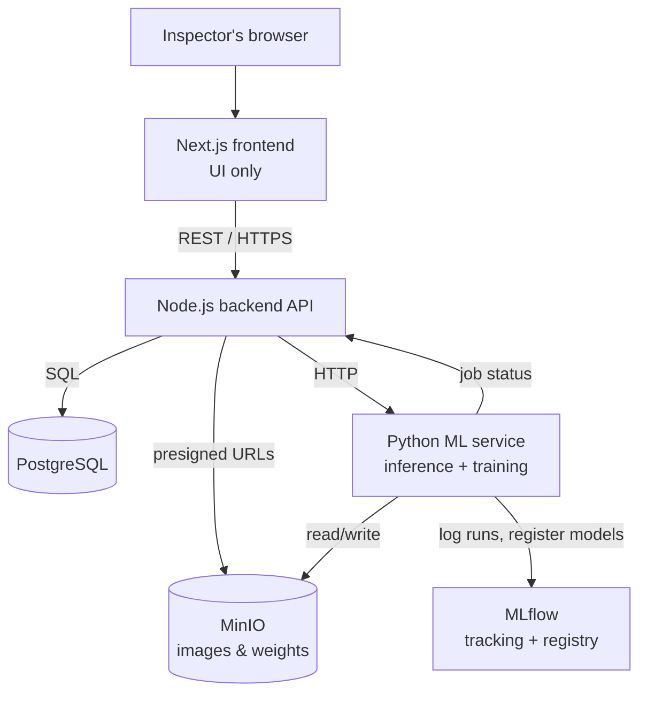
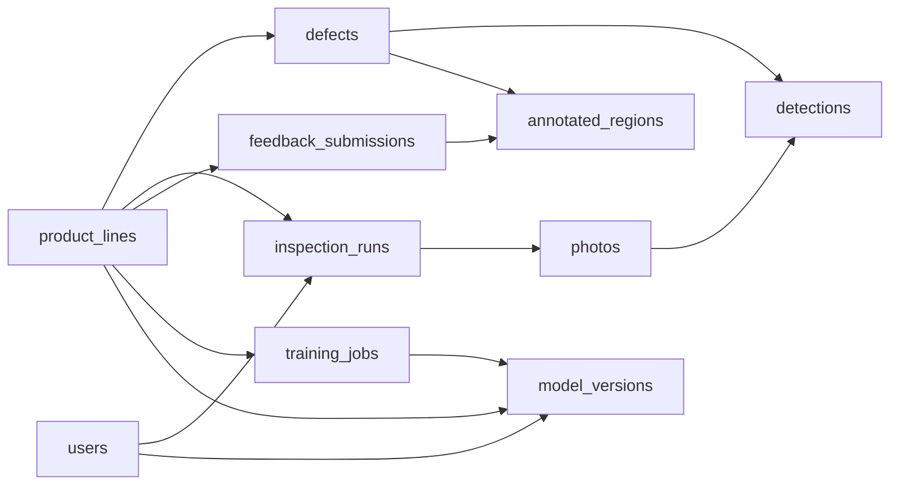
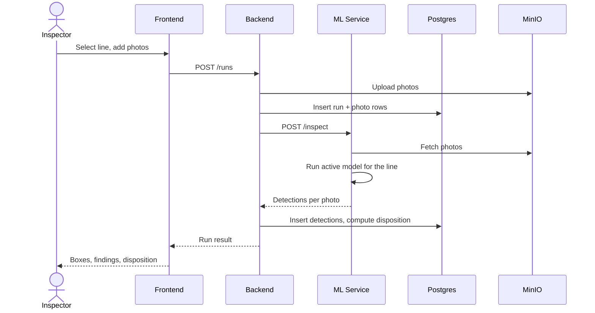
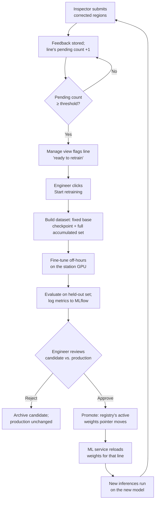
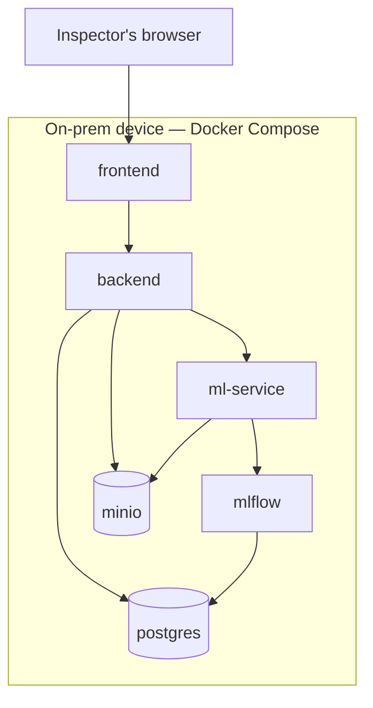

# FA-Bench System Design

*Last updated: 2026-09-19*

## Overview

FA-Bench is a physical-defect inspection console for returned AMD hardware — Ryzen, EPYC, Threadripper, Radeon, and Instinct product lines — used at an on-prem inspection station. The current `debugging_frontend` codebase is a working Next.js UI (Inspect → History → Manage) wired to a mock detector, with every run, edit, and submission held only in the browser tab's memory.

This document designs the real system behind that UI: a persistent PostgreSQL backend, a real per-product-line computer-vision inference service, and a human-in-the-loop retraining pipeline that turns inspector corrections into improved model weights, all running on a single on-premise device.

**In scope:** backend, database, inference service, retraining pipeline, and auth for one on-prem device.
**Out of scope:** multi-site/networked deployment, RMA/ticketing system integration (a plain downloadable report is sufficient), any cloud hosting at all — image and dataset storage now runs locally too, via MinIO.

## Goals & constraints

The following decisions scope this design:

| Area | Decision |
| --- | --- |
| Deployment | One on-premise device per site, not a networked multi-station system |
| Services | Three separate deployables: Next.js frontend, Node.js backend API, Python ML service |
| Database | PostgreSQL; owns all persistent state |
| Product lines | A table, rows addable over time; each line references its own model/weight version |
| Knowledge base | Per-line defect vocabulary, DB-backed CRUD, not a fixed enum |
| Auth | Per-person login; inspector and approver roles at minimum |
| Report | Plain downloadable/printable file; no external ticketing integration |
| Retraining | A real human-feedback pipeline — see Retraining pipeline below |
| Image/dataset storage | MinIO (self-hosted, on-device) |
| Orchestration | Docker Compose |

## System architecture

Three services talk over plain internal HTTP — no gRPC needed at this scale. PostgreSQL has exactly one writer: the Backend API. The ML service never opens a direct database connection; it gets photos, defect vocabulary, and job parameters via Backend calls, and reports results the same way, so schema migrations stay single-owner.

The ML service holds its own in-process job queue for retraining — one GPU means one training job at a time is enough, so nothing heavier (Celery, Redis) is needed for v1.

## Data model

Ten tables, all owned by the Backend API.

### Inspection domain

**product_lines**

| Column | Type | Notes |
| --- | --- | --- |
| id | uuid PK | |
| slug | text, unique | e.g. `ryzen-9000` |
| name | text | |
| packaging | text | e.g. `AM5 · LGA-1718` |
| family | enum | `lga` \| `board` \| `oam` |
| active_model_version_id | FK → model_versions, nullable | current production weights |
| created_at | timestamptz | |

**defects**

| Column | Type | Notes |
| --- | --- | --- |
| id | uuid PK | |
| product_line_id | FK → product_lines | |
| key | text | slug, unique per line |
| name | text | |
| severity | enum | `critical` \| `major` \| `cosmetic` |
| description | text | |
| impacts | text[] | operational impact bullets |

**users**

| Column | Type | Notes |
| --- | --- | --- |
| id | uuid PK | |
| name | text | |
| email | text, unique | |
| role | enum | `inspector` \| `approver` \| `admin` |

**inspection_runs**

| Column | Type | Notes |
| --- | --- | --- |
| id | uuid PK | |
| product_line_id | FK → product_lines | |
| operator_id | FK → users | |
| model_version_id | FK → model_versions | snapshot of which weights ran |
| status | enum | `running` \| `done` \| `failed` |
| disposition | enum, nullable | `scrap` \| `rework-review` \| `pass` |
| started_at, completed_at | timestamptz | |

**photos**

| Column | Type | Notes |
| --- | --- | --- |
| id | uuid PK | |
| inspection_run_id | FK → inspection_runs | |
| object_key | text | MinIO key |
| original_filename | text | |

**detections**

| Column | Type | Notes |
| --- | --- | --- |
| id | uuid PK | |
| photo_id | FK → photos | |
| defect_id | FK → defects, nullable, `ON DELETE SET NULL` | |
| defect_key_snapshot | text | keeps the name if the defect is later deleted — the same fallback the prototype's `resolveDefect` already does |
| confidence | numeric | |
| box | jsonb | `{x, y, width, height}`, normalised 0–1 |

### Retraining domain

**feedback_submissions**

| Column | Type | Notes |
| --- | --- | --- |
| id | uuid PK | |
| product_line_id | FK → product_lines | |
| submitted_by | FK → users | |
| object_key | text | MinIO key |
| submitted_at | timestamptz | |

**annotated_regions**

| Column | Type | Notes |
| --- | --- | --- |
| id | uuid PK | |
| feedback_submission_id | FK → feedback_submissions | |
| defect_id | FK → defects | |
| box | jsonb | `{x, y, width, height}` |

**training_jobs**

| Column | Type | Notes |
| --- | --- | --- |
| id | uuid PK | |
| product_line_id | FK → product_lines | |
| triggered_by | FK → users | |
| dataset_version | text | accumulated-set version used |
| base_checkpoint_uri | text | the line's fixed base weights |
| status | enum | `queued` \| `running` \| `evaluating` \| `awaiting_approval` \| `promoted` \| `rejected` \| `failed` |
| result_model_version_id | FK → model_versions, nullable | |
| started_at, finished_at | timestamptz | |

**model_versions**

| Column | Type | Notes |
| --- | --- | --- |
| id | uuid PK | |
| product_line_id | FK → product_lines | |
| version | text | e.g. `v7` |
| weights_uri | text | MinIO path |
| mlflow_run_id | text | |
| metrics | jsonb | per-class precision/recall, critical-defect recall |
| status | enum | `candidate` \| `approved` \| `production` \| `archived` |
| approved_by | FK → users, nullable | |
| created_at, approved_at | timestamptz | |

## Core workflows

Running an inspection is the flagship flow — photo in, disposition out:

Building a report fetches the persisted run and its detections from the Backend, rasterises each photo with its boxes burned in client-side, and downloads one self-contained HTML file — no extra service involved.

Submitting feedback has the inspector load a photo, draw regions against the line's knowledge base, and POST them to the Backend, which stores a `feedback_submission` and its `annotated_regions` and increments that line's pending-retrain count.

## Retraining pipeline

Human-gated end to end — no candidate model reaches production without a person approving it:

Fixed parameters agreed for this loop:

- **Trigger** — threshold-notify, human-started. Crossing the pending-count threshold surfaces a prompt; it never starts a job by itself.
- **Training base** — every retrain fine-tunes from the line's fixed base checkpoint over the *full* accumulated dataset, not incrementally from the prior production weights. Costs longer runs as the dataset grows, buys reproducibility and no compounding drift.
- **Compute** — same GPU that serves live inference, scheduled off-hours so training never competes with an inspector mid-run.
- **Evaluation** — a held-out validation set per product line that new examples never join; critical-defect recall is the headline metric, logged to MLflow alongside the rest.
- **Promotion** — an approver reviews candidate-vs-production metrics and explicitly promotes or rejects; a rejected candidate is archived, production is untouched.
- **Rollback** — the previous production `model_version` stays `archived`, not deleted, so it can be re-promoted if the new one misbehaves in the field.

Dataset images, COCO-format annotations, and weight artifacts all live in MinIO; MLflow tracks every run's metrics and doubles as the model registry.

## Deployment topology

Six containers on one device via Docker Compose — nothing has to leave it:

- `postgres` and `minio` are the two stateful containers that aren't disposable — together they hold run history, the knowledge base, MLflow's tracking metadata, every photo, every training dataset, and every model's weights file. Their volumes are what backups must cover.
- `frontend`, `backend`, and `ml-service` are stateless and can restart or redeploy freely; `restart: unless-stopped` on all six is enough supervision for a single box.
- MinIO now runs alongside Postgres in the compose stack — its volume holds every photo, dataset, and weights file, so it needs the same backup coverage Postgres already gets. Nothing in the runtime path needs the internet anymore; the device can run fully air-gapped.

## Open questions

- [ ] Exact retrain threshold per product line — start conservative and tune per line's defect rarity?
- [ ] MinIO durability mode — single drive (simplest, no redundancy) vs. erasure-coded across multiple drives on the same box (survives a drive failure, needs ≥ 4 drives)?
- [ ] Whether MLflow's metadata lives in its own Postgres database or a schema inside the main one
- [ ] The Backend ↔ ML service API contract — exact request/response shape, and how the two authenticate to each other
- [ ] Safeguard if an inspector needs the GPU while an off-hours retrain overruns into shift start
- [ ] Whether `approver` and `admin` are ever the same person day one, or two real roles from the start
- [ ] Backup/restore cadence for the on-prem Postgres AND MinIO volumes
